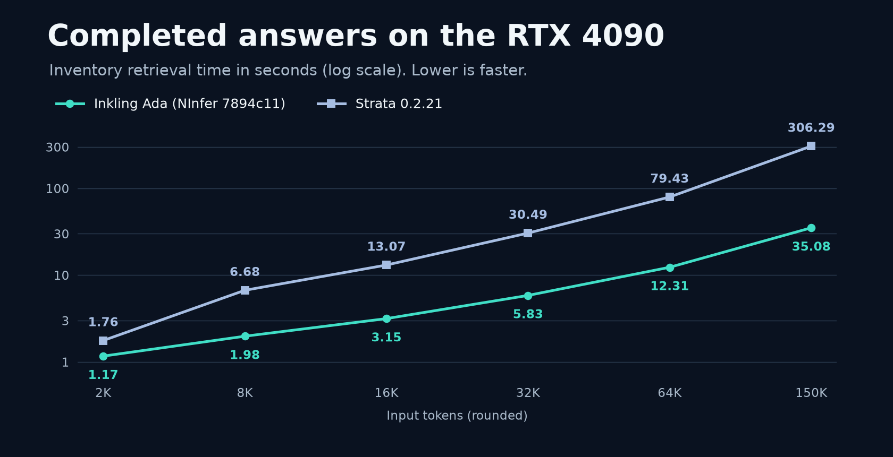

# Inkling Ada

Inkling Ada serves Thinking Machines’ [Inkling 2 Mini](https://huggingface.co/thinkingmachines/Inkling-2-Mini) on an RTX 4090. The default engine is [NInfer-all revision `7894c11`](https://github.com/iamwavecut/ninfer-all/tree/7894c119f638eb6cae52e4b3e8efc53ebaad216b), built from clean upstream source for SM89. The project publishes reproducible serving benchmarks and the earlier SM89 tensor-core attention experiment.

[Quick start](#get-started) · [Benchmarks](#rtx-4090-benchmarks) · [Contributing](#contributing)

## Get started

### One-shot agent deployment

The [Inkling Ada deploy skill](.agents/skills/inkling-ada-deploy/SKILL.md) prepares the pinned SM89 build and model, starts the loopback server, and verifies a completed reply.

Codex discovers the skill from this checkout. To install a personal copy for use from another workspace, run these commands in the environment where your agent runs.

```bash
git clone https://github.com/Fleetborn/inkling-ada.git
cd inkling-ada
mkdir -p "$HOME/.agents/skills"
cp -R .agents/skills/inkling-ada-deploy "$HOME/.agents/skills/"
```

If you already cloned the repo, run the last two commands from its root. For another agent, copy the [entire skill folder](.agents/skills/inkling-ada-deploy) into that agent's skills directory. Include `SKILL.md`, `agents/`, `references/`, and `scripts/`.

Then give your agent one request.

> Use `$inkling-ada-deploy` to start Inkling 2 Mini on my Linux RTX 4090 and verify a completed reply.

### Manual setup

On the Linux GPU host, [prepare the default engine and model](.agents/skills/inkling-ada-deploy/references/prepare.md). The recipe builds NInfer `7894c11` for SM89 and verifies the mainline-drafter UD-IQ4_XS artifact at revision `0baae7f`. From the Inkling Ada checkout, start the prepared server and verify a completed reply.

```bash
python3 .agents/skills/inkling-ada-deploy/scripts/start_server.py --repo "$PWD"
```

Run the six completed-answer fixtures in a second terminal. Use the same run number for each build or drafting mode. The suite covers arithmetic, prose, two inventory lookups, a verbatim handoff and a one-operator Python edit. The handoff and code edit require the full expected answer and a normal stop.

```bash
python3 benchmark_completed.py 8080 1
```

The server binds to loopback, keeps experts on the GPU, and uses a 16,384-token context, FP16 KV, one active sequence and plain decoding. Add `--spec dspark` to test the drafter. The launcher accepts explicit `--engine` and `--model` paths, and `serve.sh` remains the low-level runner for experiments.

### Compare engine builds and drafting modes

Build A from NInfer `18029c8e0ce2555bb499e04be24d7a4e9c12a5bc` with our [SM89 tensor-QK patch](docs/sm89-tensor-qk.md#apply-and-reproduce). Build B from clean NInfer [`7894c119f638eb6cae52e4b3e8efc53ebaad216b`](https://github.com/iamwavecut/ninfer-all/tree/7894c119f638eb6cae52e4b3e8efc53ebaad216b). Target SM89 and record both binary hashes and CUDA compiler versions. Use `bash serve.sh "$engine" "$model" 8080 none` for both. Use the older UD-IQ4_XS artifact for this two-build, plain-decoding comparison. Verify its SHA-256 is `a4a1bbfbdc1150cecc9df2bc12ae87c076330bff81579e243e7875115329bb54`. [Historical benchmark artifact](https://huggingface.co/WaveCut/Inkling-2-Mini-UD-IQ4_XS-NInfer-v3/tree/50d6ad60cfcd170633ead778e3a09958fc1e7887)

Run `python3 benchmark_completed.py 8080 "$run" > "$label-$run.jsonl"` with a distinct label per build or mode. Restart the benchmark server at the start of each of four blocks, including between the two B blocks. Run A with IDs 1 and 2, B with 1 and 2, B with 3 and 4, then A with 3 and 4. Use the same smoke warmup and fixture order throughout, with persistent prefix caching off. Pair by run and prompt hash. Check all six normal stops and fixture validations, then compare per-fixture median time to first visible answer and completion. Report answer hashes, output and cached token counts, and any differences in cache hits or output lengths alongside latency.

For a separate, build-B-only drafting comparison, switch to the newer UD-IQ4_XS artifact containing the **mainline DSpark drafter**. Verify SHA-256 `d96986947048ed3ac643da0ed6c389e8ab821f66d10e2abf1f4347224b4180db` and use that file for every mode, including plain decoding. Build B can use the older pinned artifact for plain decoding. DSpark requires the newer layout. [Matched UD-IQ4_XS artifact](https://huggingface.co/WaveCut/Inkling-2-Mini-UD-IQ4_XS-NInfer-v3/tree/0baae7fdb07506ec285bd334f2671a889aa890c0) · [Artifact requirements](https://github.com/iamwavecut/ninfer-all/blob/7894c119f638eb6cae52e4b3e8efc53ebaad216b/docs/inkling2.md#L189-L202)

```bash
common=(--host 127.0.0.1 --port 8080 --model-id inkling-2-mini --max-context 16384
        --max-concurrency 1 --expert-residency device --kv-dtype fp16)
# Start one server at a time in the order shown. Run IDs 1 through 4 before switching modes.
"$engine_b" "$model_mainline" "${common[@]}" --spec none
"$engine_b" "$model_mainline" "${common[@]}" --spec none --lookup-ngram 3 --draft-tokens 3
"$engine_b" "$model_mainline" "${common[@]}" --spec dspark --draft-tokens 3
"$engine_b" "$model_mainline" "${common[@]}" --spec dspark --draft-tokens 3 --lookup-ngram 3
```

Check the server log for the selected mode and record proposed and accepted draft counts where available. The lookup-only run proposes continuations already present in the sequence. DSpark uses the artifact's drafter. In the combined mode, the scheduler tries lookup first and can call DSpark when lookup misses. [Inkling draft selection](https://github.com/iamwavecut/ninfer-all/blob/7894c119f638eb6cae52e4b3e8efc53ebaad216b/src/runtime/engine/inkling2_core.cpp#L2439-L2466)

## RTX 4090 benchmarks

### November 25, 2026 · Trappist

Inkling Ada’s default engine, clean NInfer `7894c11`, completed the 150K retrieval in **35.08 s**, versus **174.01 s** for our patched `18029c8` and **306.29 s** for production Strata 0.2.21. Both NInfer builds used CUDA 12.9.86 for SM89, the same older UD-IQ4_XS artifact, GPU-resident experts, MXFP8 KV and a 163,840-token context. Strata ran its production SQ-20 weights, FP8 KV, 393,216-token cap and 64-token chunks with vision loaded. All three served one benchmark request at a time with drafting off. [Configurations and raw requests](results/rtx4090-strata-0221-ninfer-context-drafting.json)



| Prompt tokens (NInfer / Strata) | Patched Ada (s) | Clean NInfer `7894c11` (s) | Strata 0.2.21 (s) |
| --- | ---: | ---: | ---: |
| 2,161 / 2,163 | 1.38 | 1.17 | 1.76 |
| 8,461 / 8,463 | 2.95 | 1.98 | 6.68 |
| 15,661 / 15,663 | 5.60 | 3.15 | 13.07 |
| 31,662 / 31,664 | 13.75 | 5.83 | 30.49 |
| 64,062 / 64,064 | 40.13 | 12.31 | 79.43 |
| 150,062 / 150,064 | 174.01 | 35.08 | 306.29 |

Each cell is the completion time for one request. All 18 requests returned the expected answer and reported zero cached prompt tokens. At 150K, time to first streamed token was 172.23 s for patched Ada, 33.93 s for clean NInfer and 305.99 s for Strata. Their sampled peak GPU memory was 20,222, 20,246 and 21,796 MiB respectively, sampled every 500 ms.

Each pair below gives **prefill / decode** in tokens per second for the same single request. Prefill uses the server's `prompt_per_second` (processed prompt tokens, `prompt_n`, divided by prompt time). Decode uses `predicted_per_second`. For these requests, NInfer counts the steps after the first output token (`predicted_n - 1`) and Strata counts all `predicted_n` output tokens, each divided by the server's decode time. At 150K, patched Ada generated 124 tokens, clean NInfer 119, and Strata 17. Short outputs make a single-request decode rate sensitive to timing.

| Prompt size | Patched Ada | Clean NInfer `7894c11` | Strata 0.2.21 |
| --- | ---: | ---: | ---: |
| 2K | 4,521 / 130.3 | 6,438 / 142.3 | 1,358 / 111.1 |
| 8K | 4,085 / 125.0 | 7,072 / 138.9 | 1,301 / 108.1 |
| 16K | 3,399 / 119.5 | 6,885 / 134.8 | 1,216 / 105.2 |
| 32K | 2,503 / 109.8 | 6,484 / 127.2 | 1,045 / 99.4 |
| 64K | 1,649 / 94.0 | 5,756 / 118.5 | 809 / 89.1 |
| 150K | 872 / 68.0 | 4,429 / 100.9 | 491 / 56.4 |

On the short fixtures, Strata completed arithmetic in 0.071 s and prose in 0.766 s in one request each. The corresponding plain NInfer medians across four requests were 0.419 s and 2.300 s for patched Ada, and 0.388 s and 2.257 s for clean NInfer.

For the drafting comparison, clean NInfer used the newer UD-IQ4_XS artifact with the mainline drafter, 16K context and FP16 KV throughout. The four modes ran in the fixed order shown from left to right, with four runs per mode. Each pair gives the median completion time in seconds and median server-reported decode rate in tokens per second. All 96 requests across the six fixtures passed. [Per-request answers and timings](results/rtx4090-strata-0221-ninfer-context-drafting.json)

| Fixture | Plain | Lookup only | DSpark | Lookup + DSpark |
| --- | ---: | ---: | ---: | ---: |
| Verbatim copy | 2.008 / 148.0 | 1.541 / 188.1 | 1.237 / 251.2 | 1.220 / 247.8 |
| Code edit | 1.674 / 147.8 | 1.188 / 211.7 | 0.992 / 256.8 | 0.961 / 265.7 |

### Longer prompts

For the two NInfer runs, set `engine` to the path of the patched `18029c8` binary for the first run and the clean `7894c11` binary for the second. Set `model` to the older UD-IQ4_XS artifact verified above. Start one server at a time.

```bash
"$engine" "$model" --host 127.0.0.1 --port 8080 --model-id inkling-2-mini \
  --max-context 163840 --max-concurrency 1 --expert-residency device \
  --kv-dtype mxfp8 --spec none
```

In a second terminal, run the same six-point sweep against each server. Set `label` to `patched`, `upstream` or `strata` for separate output files. If Strata listens on another port, use its port in the client command. Record the effective server cap for each engine. The largest input needs about 150,060 tokens plus room for 1,024 output tokens.

```bash
python3 benchmark_completed.py 8080 1 --model-id inkling-2-mini --context-sweep > "$label-context-run-1.jsonl"
```

The client warms the server with a READY request, then sends inventories of 105, 420, 780, 1,580, 3,200 and 7,500 rows. Each size has a distinct opening to limit prefix reuse. Check cached tokens when comparing cold latency. Each JSON line gives the target length, validation result and any request error. Completed requests also include the server-reported prompt length, answer, cache usage and timings when supplied. Validation requires the correct two integers, a normal stop and a reported length within 32 tokens of the estimate calibrated on the historical prompts (20 tokens per row plus 59). A failed warmup emits six failed records without sending retrieval requests. A failed retrieval still allows later points to run. Either failure makes the command exit nonzero. The socket timeout is 600 seconds.

In a separate matched-weights experiment, the tensor QK patch reduced median completion time from 3.010 to 2.796 seconds on the 8,459-token fixture. [Experiment and numerical checks](docs/sm89-tensor-qk.md)

The [original llama.cpp baseline](docs/llama-cpp-baseline.md) measures a synthetic 128-token output cap. Its measured requests reached that cap during reasoning.

### 500K llama.cpp context trial

In a separate November 21, 2026 run on an RTX 4090, [Unsloth llama.cpp b12588](https://github.com/unslothai/llama.cpp/releases/tag/b12588-mix-c0c3de8) loaded a 524,288-token context and accepted one synthetic 500,014-token retrieval prompt. The run used UD-IQ4_XS weights, a Q4_0 KV cache, a 32-token microbatch, all model layers on the GPU, and speculative decoding disabled.

| Prompt tokens processed | Prefill elapsed | Cumulative prefill |
| ---: | ---: | ---: |
| 100,364 | 191.43 s | 524.30 tok/s |
| 200,716 | 558.34 s | 359.49 tok/s |
| 301,068 | 1,110.32 s | 271.16 tok/s |
| 356,364 | 1,495.86 s | 238.23 tok/s |

The request timed out at 1,500 seconds before its first answer. The table shows partial prefill measurements. Full-prompt latency, retrieval accuracy, and decode throughput remain unmeasured at this length.

## Contributing

Independent benchmark runs, correctness tests, focused SM89 improvements, and build documentation are welcome. Open an [issue](https://github.com/Fleetborn/inkling-ada/issues/new) describing the hardware, model, settings, and observed result before starting a larger change. For a small fix, open a pull request with the relevant check or measurement. Preserve raw results and explain differences in weights, context, cache, and decoding settings when comparing runs.

Inkling Ada uses the [Apache 2.0 license](LICENSE). The [logo](assets/inkling-ada-logo.png) and [share image](assets/inkling-ada-banner.jpg) are in the repository.

## Acknowledgments

NInfer-all provides the foundation for this work. [Basalt](https://github.com/jesdga95/basalt/blob/main/docs/models/inkling2.md) and [Strata](https://github.com/Niko1221/Strata) provide technical inspiration for Inkling attention, cache design, speculative decoding, and expert placement.
