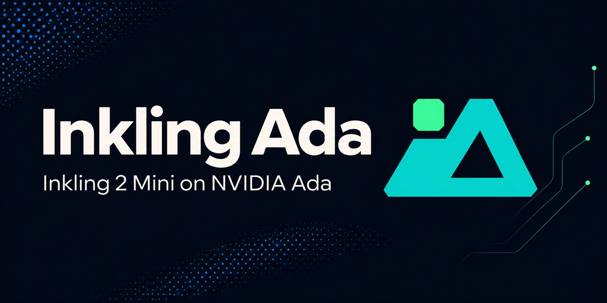

# Inkling Ada

Inkling Ada is an open-source experiment in serving Thinking Machines’ [Inkling 2 Mini](https://huggingface.co/thinkingmachines/Inkling-2-Mini) on an RTX 4090. It builds on [NInfer-all](https://github.com/iamwavecut/ninfer-all) for CUDA execution, model loading, and an OpenAI-compatible API. It pairs an SM89 tensor-core attention patch with reproducible serving benchmarks and raw results.

[Quick start](#get-started) · [Benchmarks](#rtx-4090-benchmarks) · [Contributing](#contributing)

## Get started

### One-shot agent deployment

Use the [Inkling Ada deploy skill](.agents/skills/inkling-ada-deploy/SKILL.md) from a checkout. It prepares the pinned SM89 build and model, starts the loopback server, and verifies a completed reply.

> Use `$inkling-ada-deploy` to start Inkling 2 Mini on my Linux RTX 4090 and verify a completed reply.

To use it elsewhere, copy the entire [`.agents/skills/inkling-ada-deploy` folder](.agents/skills/inkling-ada-deploy) into your agent's skills directory. Include `references/` and `scripts/` so the build instructions and launcher travel with the skill. Codex discovers project skills from a checkout and uses `~/.agents/skills/` for a personal copy.

### Manual setup

Use a supported NVIDIA driver and an Inkling-capable CUDA Linux archive from [NInfer-all releases](https://github.com/iamwavecut/ninfer-all/releases). Verify the numbered archive parts against its SHA-256 manifest and check the distribution requirements for that release. On older Linux hosts, use its Dockerfile and NVIDIA Container Toolkit as described in the [NInfer Linux release guide](https://github.com/iamwavecut/ninfer-all/blob/master/docs/release-archive-linux.md).

Download the [UD-IQ4_XS NInfer artifact](https://huggingface.co/WaveCut/Inkling-2-Mini-UD-IQ4_XS-NInfer-v3), then start the stock upstream server in one terminal.

```bash
bash serve.sh /path/to/ninfer-serve /path/to/Inkling-2-Mini-UD-IQ4_XS-ninfer-v3.ninfer
```

Run the four completed-answer fixtures in a second terminal.

```bash
python3 benchmark_completed.py 8080 1
```

The `serve.sh` launcher binds the server to loopback, keeps experts on the GPU, and uses a 16,384-token context, FP16 KV, and one active sequence. Append `8080 dspark` to the `serve.sh` command to enable speculative decoding. The commands above run the stock release. For the patched binary and matched scalar baseline, use the [pinned SM89 build instructions](docs/sm89-tensor-qk.md#apply-and-reproduce).

## RTX 4090 benchmarks

Each benchmark ran one stream on the same RTX 4090. Ada used UD-IQ4_XS and the tensor QK patch. Strata v0.2.19 used its Inkling engine 0.1.65 and SQ-20 weights. Both used FP16 KV and a 16,384-token context for these four fixtures. Each number is the median completion time of four requests, all of which passed their fixture checks. Output lengths and prose wording can differ.

| Fixture | Prompt tokens | Ada | Strata | Strata + DSpark |
| --- | ---: | ---: | ---: | ---: |
| Arithmetic | 30 | 0.419 s | 0.595 s | 0.332 s |
| Prose | 52 | 2.298 s | 3.376 s | 2.072 s |
| Inventory retrieval | 2,159 | 1.381 s | 1.981 s | 1.197 s |
| Inventory retrieval | 8,459 | 2.791 s | 3.880 s | 3.142 s |

Strata with DSpark led on arithmetic, prose, and the 2,159-token lookup. Ada led at 8,459 tokens. The stacks use different weight packs and can generate different numbers of tokens. [Completed-answer data](results/rtx4090-strata-completed.json)

### Longer prompts


The longer context sweep ran one correct completed retrieval request per point. Ada used UD-IQ4_XS, FP16 KV, and a configured 65,536-token context. Strata used SQ-20, FP8 KV, 64-token chunks, and no drafting after DSpark exhausted VRAM in the large configuration. Its CUDA configuration was automatically capped at 286,912 tokens.

| Prompt tokens | Ada completion | Strata completion |
| ---: | ---: | ---: |
| 15,659 | 4.706 s | 15.911 s |
| 31,659 | 10.218 s | 35.011 s |
| 64,059 | 26.024 s | 86.232 s |

At a verified 307,459-token prompt, Ada allocated a 327,680-token MXFP8 KV cache and prefilled about 141,000 tokens before the 152-second cutoff. The recorded first attempt exited after 59 seconds because of a harness error. Strata was limited by its 286,912-token KV cap. The 307K experiment recorded partial prefill and a capacity limit. [Context sweep data](results/rtx4090-context-sweep.json)

In a separate matched-weights experiment, the tensor QK patch reduced median completion time from 3.010 to 2.796 seconds on the 8,459-token fixture. [Experiment and numerical checks](docs/sm89-tensor-qk.md)

The [original llama.cpp baseline](docs/llama-cpp-baseline.md) measures a synthetic 128-token output cap. Its measured requests reached that cap during reasoning.

## Contributing

Independent benchmark runs, correctness tests, focused SM89 improvements, and build documentation are welcome. Open an [issue](https://github.com/Fleetborn/inkling-ada/issues/new) describing the hardware, model, settings, and observed result before starting a larger change. For a small fix, open a pull request with the relevant check or measurement. Preserve raw results and explain differences in weights, context, cache, and decoding settings when comparing runs.

Inkling Ada uses the [Apache 2.0 license](LICENSE). The [logo](assets/inkling-ada-logo.png) and [share image](assets/inkling-ada-banner.jpg) are in the repository.

## Acknowledgments

NInfer-all provides the foundation for this work. [Basalt](https://github.com/jesdga95/basalt/blob/main/docs/models/inkling2.md) and [Strata](https://github.com/Niko1221/Strata) provide technical inspiration for Inkling attention, cache design, speculative decoding, and expert placement.
